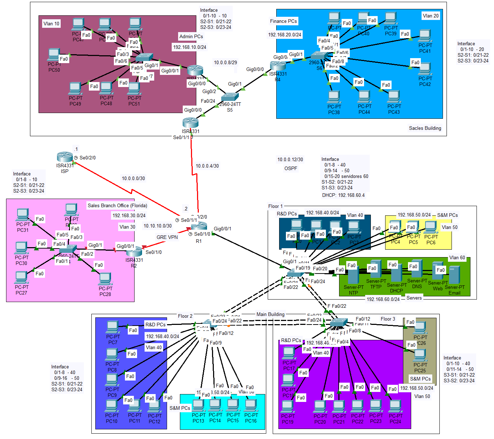

# 🌐 NetLab — Enterprise Network Infrastructure Lab

**Laboratorio de infraestructura de red empresarial desarrollado en Cisco Packet Tracer.**

NetLab es un proyecto práctico orientado al diseño, implementación y administración de una infraestructura de red empresarial. Simula un entorno corporativo con múltiples departamentos, segmentación lógica, conectividad entre redes, servicios centralizados y comunicación con redes externas.

El proyecto permite aplicar conceptos fundamentales de networking, routing, switching, administración de servicios y seguridad de redes mediante configuraciones y pruebas en dispositivos Cisco.

---

## 📸 Topología de red



*Topología lógica de la infraestructura empresarial implementada en Cisco Packet Tracer.*

## 🎯 Objetivos del proyecto

- Diseñar e implementar una infraestructura de red empresarial segmentada mediante VLAN.
- Configurar comunicación entre diferentes redes y departamentos.
- Implementar enrutamiento dinámico y servicios de asignación automática de direcciones IP.
- Centralizar servicios de red para los distintos segmentos.
- Configurar conectividad hacia redes externas mediante NAT/PAT.
- Aplicar mecanismos de seguridad y control de acceso.
- Realizar pruebas de conectividad y troubleshooting.

## 🏢 Segmentación de red — VLAN

La infraestructura está organizada en seis VLAN, permitiendo separar los departamentos y servicios de acuerdo con sus funciones.

| VLAN | Departamento / Área | Red |
|---|---|---|
| 10 | Administración | `192.168.10.0/24` |
| 20 | Finanzas | `192.168.20.0/24` |
| 30 | Sucursal Florida | `192.168.30.0/24` |
| 40 | R&D (Research & Development) | `192.168.40.0/24` |
| 50 | S&M (Sales & Marketing) | `192.168.50.0/24` |
| 60 | Servidores | `192.168.60.0/24` |

Esta segmentación permite organizar el tráfico, separar los dominios de broadcast y facilitar la administración de la infraestructura.

## ⚙️ Tecnologías y configuraciones implementadas

### Switching
- Creación y administración de VLAN.
- Configuración de enlaces troncales 802.1Q.
- Comunicación entre switches.
- Router-on-a-Stick (ROAS) para el enrutamiento inter-VLAN.

### Routing
- Enrutamiento dinámico mediante OSPF.
- Comunicación entre diferentes segmentos de red.
- DHCP Relay para la comunicación con el servidor DHCP centralizado.
- NAT/PAT para la traducción de direcciones y salida hacia redes externas.

### Servicios de red
- DHCP: asignación dinámica de direcciones IP.
- DNS: resolución de nombres de dominio.
- HTTP: servicio web interno.
- Email: envío y recepción de correo electrónico.
- NTP: sincronización horaria.
- TFTP: transferencia de archivos y soporte para respaldos de configuraciones.

## 🖥️ Infraestructura de servidores

Los servicios se encuentran centralizados en la VLAN 60.

| Servicio | Dirección IP | Función |
|---|---|---|
| DHCP | `192.168.60.4` | Asignación dinámica de direcciones IP |
| DNS | `192.168.60.5` | Resolución de nombres |
| HTTP | `192.168.60.6` | Alojamiento del sitio web interno |
| Email | `192.168.60.7` | Servicio de correo electrónico |
| NTP | `192.168.60.2` | Sincronización horaria |
| TFTP | `192.168.60.3` | Transferencia de archivos |

## 🧪 Pruebas y validaciones

Durante el desarrollo se realizaron pruebas para verificar el funcionamiento de los componentes de la infraestructura:

- Conectividad entre dispositivos y segmentos de red.
- Comunicación entre VLAN mediante Router-on-a-Stick.
- Asignación automática de direcciones IP mediante DHCP.
- Funcionamiento del servicio DHCP Relay.
- Resolución de nombres mediante DNS.
- Acceso al servicio web interno.
- Envío y respuesta de correos electrónicos.
- Funcionamiento de los servicios NTP y TFTP.
- Conectividad entre routers y salida mediante NAT/PAT.

## 🔐 Seguridad de red

Como parte de la evolución del laboratorio, se contempla implementar mecanismos adicionales de seguridad:

- ACL extendidas para controlar el tráfico entre redes.
- VPN GRE para establecer conectividad entre la sucursal Florida y la infraestructura principal.
- Políticas de control de acceso entre departamentos.

## 📌 Estado del proyecto

| Componente | Estado |
|---|---|
| Diseño de topología empresarial | ✅ Implementado |
| Segmentación mediante VLAN | ✅ Implementado |
| Troncales 802.1Q | ✅ Implementado |
| Router-on-a-Stick | ✅ Implementado |
| DHCP y DHCP Relay | ✅ Implementado |
| Enrutamiento OSPF | ✅ Implementado |
| NAT/PAT | ✅ Implementado |
| Servicios DNS y HTTP | ✅ Implementado |
| Servicio de correo electrónico | ✅ Implementado |
| Servicios NTP y TFTP | ✅ Implementado |
| ACL extendidas | ⏳ Pendiente |
| VPN GRE — Sucursal Florida | ⏳ Pendiente |
| Pruebas finales y documentación | ⏳ Pendiente |

## 🛠️ Herramientas utilizadas

- **Cisco Packet Tracer:** diseño, configuración y simulación de la infraestructura.
- **Cisco IOS:** configuración de routers y switches.
- **Visual Studio Code:** edición y documentación del proyecto.
- **Git:** control de versiones.
- **GitHub:** almacenamiento y publicación del repositorio.

## 📂 Estructura del repositorio

```text
NetLab/
│
├── README.md
├── topology.png
└── NetLab-Enterprise-Network.pkt
```

## 🚀 Cómo utilizar el proyecto

1. Clonar o descargar este repositorio.
2. Abrir Cisco Packet Tracer.
3. Abrir el archivo de simulación `.pkt`.
4. Explorar la topología y las configuraciones de los dispositivos.
5. Realizar pruebas de conectividad y funcionamiento de los servicios.

## 📈 Próximas mejoras

- Implementación de ACL extendidas.
- Configuración de VPN GRE entre la sede principal y la sucursal Florida.
- Pruebas de seguridad y conectividad entre departamentos.
- Documentación técnica de las configuraciones.
- Registro de evidencias y resultados de las pruebas.

---

**NetLab — Practical Networking | Enterprise Infrastructure | Cisco Packet Tracer**

*Proyecto personal de aprendizaje y desarrollo de habilidades prácticas en redes y telecomunicaciones.*
